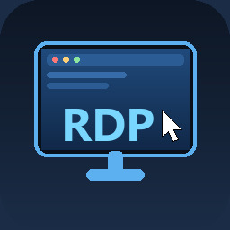

# RDP — Nintendo Switch 远程桌面客户端

<p align="center"></p>

用 devkitPro / libnx 从零写的一个原生 RDP 客户端，不依赖 FreeRDP、不依赖 OpenSSL：
X.224 → TLS → CredSSP/NLA → MCS → 能力协商 → FastPath 图形更新，全部自己实现。
位图编码支持 **RDP 6（32bpp planar）** 与 **RDP 5（16bpp interleaved RLE）**，
外加未压缩位图，两代协议都实测可用。在 Atmosphere + hbmenu 的 Switch 上连接 Windows 桌面，
1280×720 输出、增量重绘。

## 功能

- **登录**：NLA（CredSSP：NTLM + SPNEGO + 公钥校验）
- **图形**：RDP 6 位图（planar）、RDP 5 位图（interleaved RLE）、未压缩位图；只重绘脏矩形
- **鼠标**：左摇杆移动指针（速度按时间算，轻推一次 1 像素）、右摇杆上下滚轮、
  ZL/ZR 左右键、触摸屏可直接点
- **按键**：十字键方向键、A 回车、B Esc
- **文字**：Y 调系统键盘，含中文输入法，字符走 `SC_UNICODE` 直接送进远端
- **UI**：L+R 呼出会话菜单（继续远程桌面 / 输入文字 / 设置 / 断开），全中文，
  纯 framebuffer 绘制（不带 libnx console，所以没有控制台退出崩溃）

## 安装

1. 从 [Releases](https://github.com/Roguei/switch-rdp/releases/latest) 下载 `RDP_b50.zip`
   （或直接下 `RDP_b50.nro`）
2. 解压到 SD 卡根目录，得到 `SD:/switch/RDP.nro`
3. hbmenu 里选中运行；图标与标题来自 NRO 尾部的 ASET 资源段（NACP 名称 `RDP`）

## 构建

需要：devkitPro（devkitA64 + 用 GCC 15 自建的 libnx）、mbedTLS 2.28.x 的
aarch64-none-elf 版本、Python 3（打包与图标/字体生成）。

```
python tools/build_mbedtls.py <path-to-mbedtls-src>    # 一次性
make MBEDTLS=<path>/mbedtls-install PYTHON=python      # -> build/switch_rdp.nro
make hw MBEDTLS=... PYTHON=python                      # 同镜像，带图标 + NACP
make hw-bare MBEDTLS=... PYTHON=python                 # 不带 ASET 资源段（排查加载器问题）
python tools/check_nro.py build/switch_rdp_hw.nro      # 校验 NRO 头 / NACP / 图标
```

`tools/gen_ui_font.py` 扫描 `src/*.c|*.h` 里出现的所有非 ASCII 字符，用微软雅黑
16px 生成点阵字体（`src/ui_font.c`）——**改了界面文字必须重跑**。
`tools/gen_icon.py` 重新生成 `assets/icon.jpg`（256×256 JPEG）。

## 目录

| 路径 | 内容 |
|---|---|
| `src/rdp_session.c` | 连接编排、MCS 会话、能力协商、输入发送 |
| `src/rdp_mcs.c` | T.125 MCS / T.124 GCC 层 |
| `src/rdp_credssp.c` | CredSSP（NTLM + SPNEGO + 公钥校验），NLA 登录 |
| `src/rdp_tls.c` | mbedTLS 胶水，非阻塞读写与超时 |
| `src/rdp_update.c` | FastPath 更新解析：planar / interleaved RLE / 原始位图 |
| `src/rdp_input.c` | 输入事件构造、HID usage → PC 扫描码 |
| `src/ui_draw.c`、`src/ui_font.c` | framebuffer UI 与点阵字体（自动生成） |
| `src/main.c` | 界面、菜单、配置、摇杆/触摸/键盘处理 |
| `tools/` | 字体与图标生成、NRO 打包与校验、RLE 离线对拍 |
| `docs/` | 协议细节、构建工具链、测试清单、排障记录（中文） |

## 已知问题

- **USB 键盘**在 applet 模式下可能收不到输入。日志每 5 秒打一行
  `kbd states=…`：`0` 表示 HID 一条状态都没上报。系统键盘（Y）不受影响。
- 只做过 16bpp / 32bpp；8bpp 没有在真实服务器上验证。
- 没有剪贴板同步、声音、磁盘重定向。
- 鼠标指针是客户端自己画的箭头，没有做服务端光标形状。

## 文档

接手开发请从 [`docs/00_HANDOFF.md`](docs/00_HANDOFF.md) 开始：状态、不变量、
约束与下一步；协议字节级细节在 [`docs/02_PROTOCOL.md`](docs/02_PROTOCOL.md)。

## 许可

MIT，见 `LICENSE`。第三方：mbedTLS（Apache-2.0）、libnx（ISC）。
仓库里不含任何字体文件；`src/ui_font.c` 是在开发机上用微软雅黑 16px 生成的派生点阵数据。
